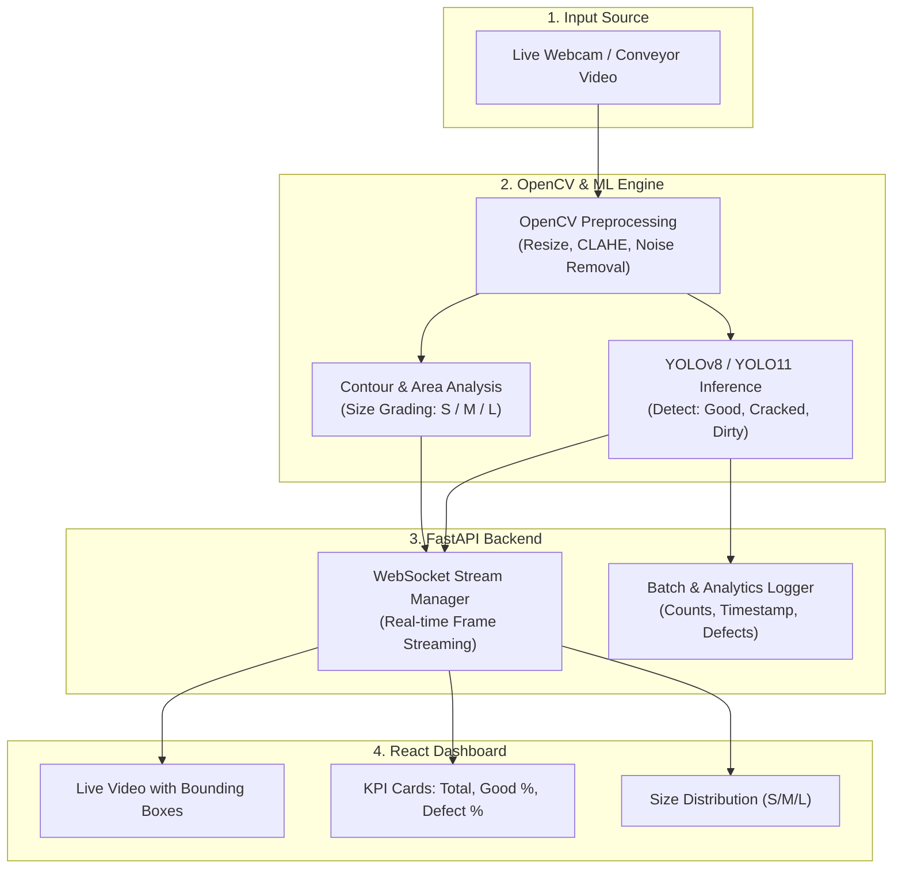

# Smart Egg Inspection & Sorting System (EggVision)

### 💡 Project Idea: "Smart Egg Inspection & Sorting System"

An automated vision system designed for industrial poultry and food processing:
1. **Real-time Egg Counting**: Accurately detect and count eggs moving along a conveyor belt or tray.
2. **Defect Detection**:
   - **Good**: Clean and structurally intact eggs.
   - **Cracked**: Shell cracks or fractures (high-priority defect).
   - **Dirty / Stained**: Dirt, mud, or organic stains on the eggshell.
3. **Size Grading**:
   - OpenCV Contour Area analysis: Classify into Small, Medium, and Large.
4. **Live Dashboard**: Real-time video feed, live counter metrics, defect rate analytics, and alerts.

---

### 🏗️ Implementation Diagram

