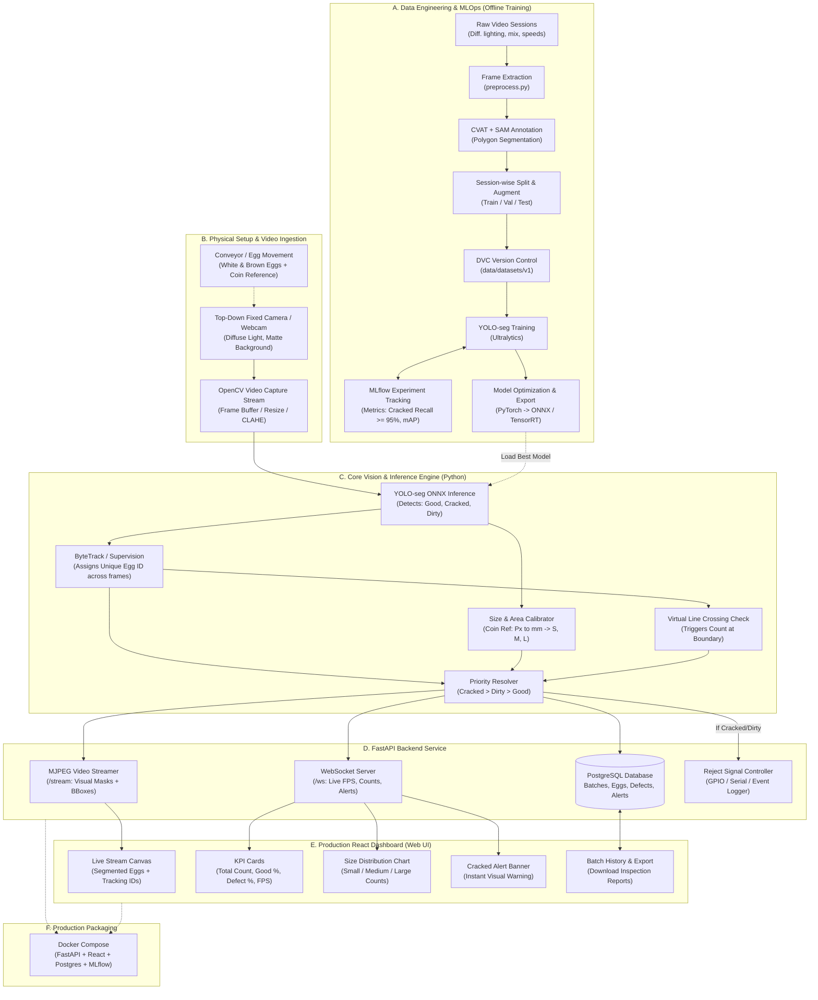

# 🥚 EggVision: Smart Egg Inspection & Sorting System

> **Production-Grade Computer Vision & AI Platform for Automated Real-Time Egg Quality Inspection, Defect Detection, Size Grading, and Sorting.**

---

## 📌 Phase 0: Problem Statement & Targets

### 1. Problem Statement
Automated computer vision system designed for poultry and egg processing conveyor lines to detect shell defects (`Cracked`, `Dirty`), grade sizes (`Small`, `Medium`, `Large`), accurately count eggs in real-time, and trigger automated sorting/rejection signals.

---

### 2. Classes & Priority Hierarchy
When an egg exhibits multiple attributes, the classification follows a strict priority:
$$\textbf{Cracked} > \textbf{Dirty} > \textbf{Good}$$

- **1. Cracked (Highest Priority):** Hairline cracks, fractures, or punctured shells. Immediate reject priority.
- **2. Dirty:** Organic stains, mud, or fecal residue on the shell (without structural cracks).
- **3. Good:** Structurally sound, clean, defect-free egg.

---

### 3. Size Classification (Pixels to Grams Calibration)
- **Small (S):** $< 53\text{g}$ (calibrated contour area threshold)
- **Medium (M):** $53\text{g} - 63\text{g}$
- **Large (L):** $> 63\text{g}$

---

### 4. Measurable Success Targets (KPIs)

| Metric | Target | Description & Justification |
| :--- | :---: | :--- |
| **Cracked Recall** | **$\ge$ 95%** | Zero tolerance for cracked eggs entering consumer packages. |
| **Count Accuracy** | **$\ge$ 98%** | Precise batch inventory tracking without duplicate counts. |
| **Size Grading Match** | **$\ge$ 90%** | Accurate physical weight matching against digital scale benchmarks. |
| **Processing Speed** | **$\ge$ 20 FPS** | Real-time, zero-lag streaming for conveyor inspection speeds. |

---

## 🏗️ End-to-End Implementation Architecture

---

## 🗺️ Project Phased Roadmap

### A. Foundation
- **Phase 0:** Problem Definition & Target KPIs (Cracked Recall $\ge$ 95%, Count $\ge$ 98%).
- **Phase 1:** Physical Setup (Fixed top-down camera, diffuse lighting, reference coin calibration).
- **Phase 2:** Dev Environment Setup (Python venv, CUDA PyTorch, OpenCV, Ultralytics, DVC, Docker, MLflow).

### B. Data Engineering
- **Phase 3:** Video Data Collection (Multiple sessions: lighting, egg mix, speed).
- **Phase 4:** Annotation (CVAT + SAM polygon segmentation, 10% quality audit).
- **Phase 5:** Dataset Preprocessing & Session-wise Split (DVC versioning, no leakage).

### C. Model Development & MLOps
- **Phase 6:** Baseline Training (YOLO-seg nano, MLflow logging).
- **Phase 7:** Model Evaluation & Error Analysis (Confusion matrix, failure inspection).
- **Phase 8:** Iterative Improvement Loop (Augmentation, hyperparameter tuning until targets are hit).

### D. Vision Logic
- **Phase 9:** Tracking & Virtual Line Counting (ByteTrack + Supervision, unique ID tracking).
- **Phase 10:** Pixel-to-mm Size Calibration (Scale calibration, contour area mapping to S/M/L).

### E. Application Stack
- **Phase 11:** FastAPI Backend (MJPEG video stream, WebSockets, PostgreSQL logging).
- **Phase 12:** React Dashboard (Real-time masks, KPI summary cards, size charts, alerts).
- **Phase 13:** Reject Signal Controller (Hardware/Simulated reject signal for defects).

### F. Finish & Productionization
- **Phase 14:** Packaging & ONNX Export (Docker Compose, latency & FPS profiling).
- **Phase 15:** Final End-to-End Stress Testing (New eggs, new lighting, target verification).
- **Phase 16:** Portfolio Documentation (Complete writeup, demo videos, learnings).

---

## ⚠️ Core Engineering Rules
1. **Test Set Hygiene:** The test split is evaluated strictly in Phases 7 and 15 only.
2. **Experiment Tracking:** Every training and evaluation run is tracked via MLflow.
3. **Data Versioning:** Any dataset change triggers a new DVC version tag.
4. **Frozen Classes:** Class definitions and priority levels are immutable across the project lifecycle.
5. **Quality Gate:** Advance to the next phase only when the current phase's "Done when" conditions are 100% satisfied.
